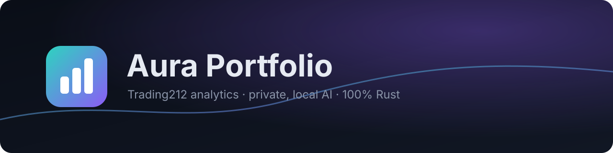
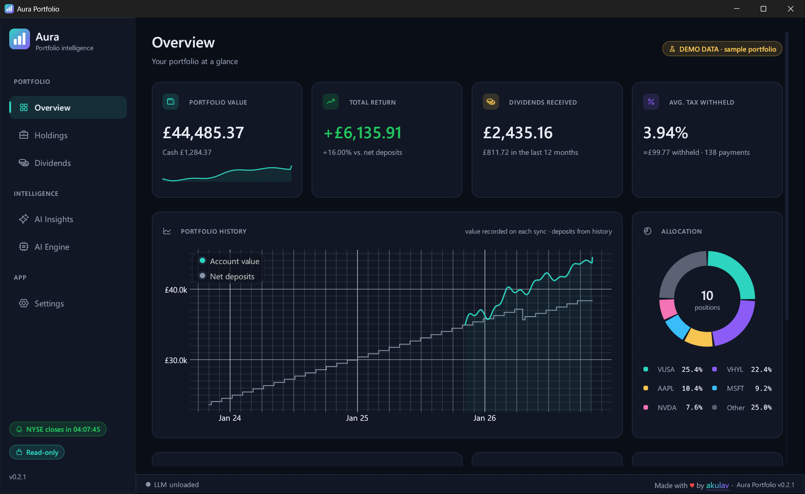
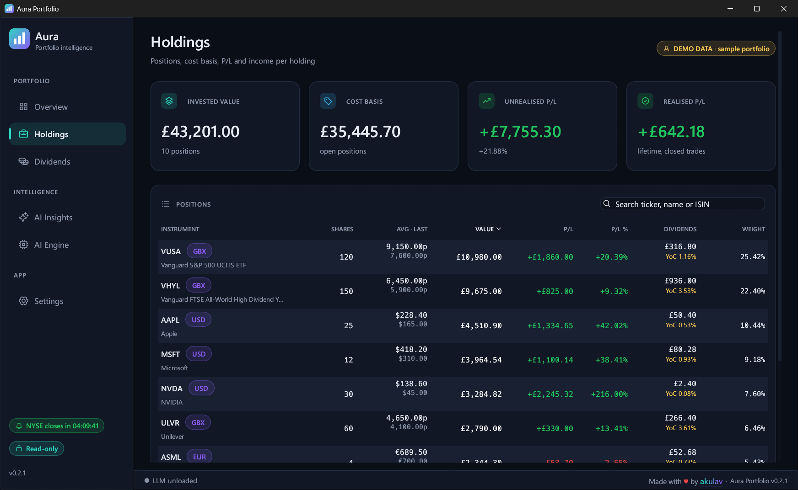
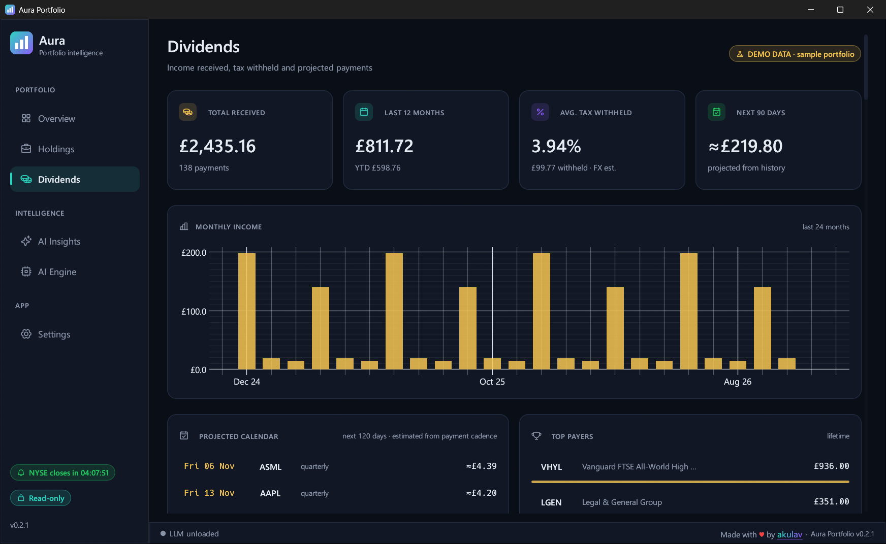
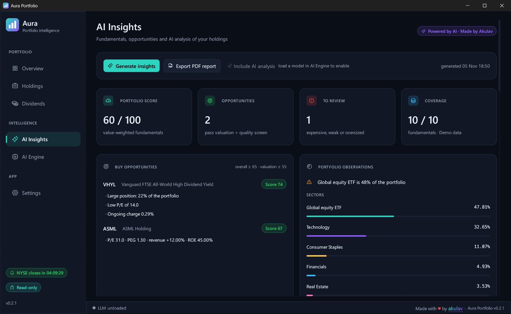
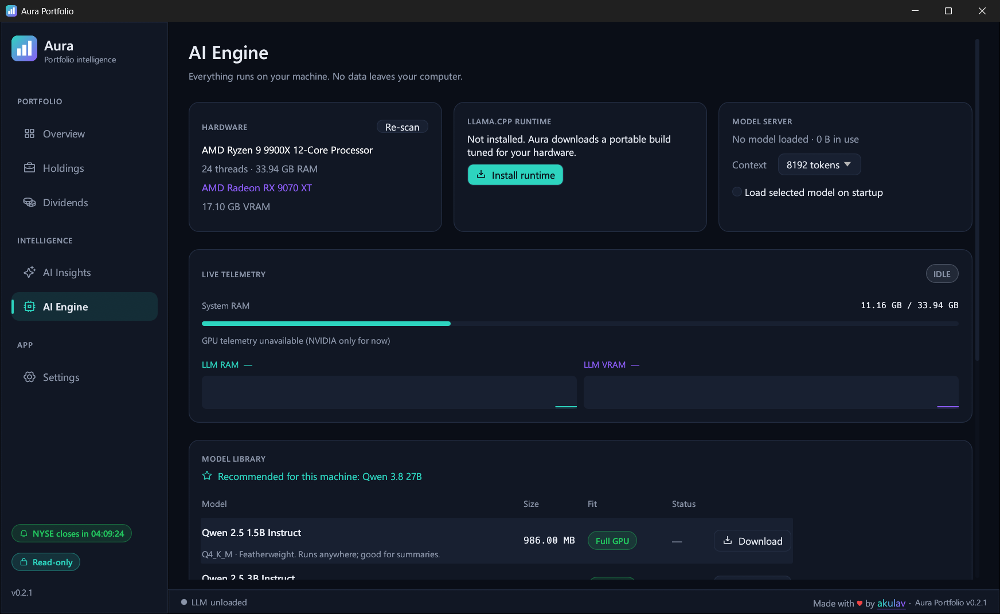
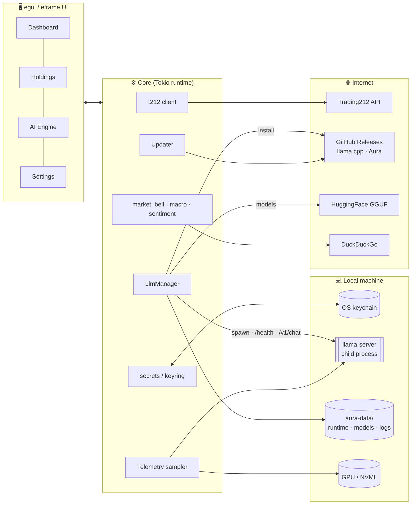

<div align="center">



<br/>


# Aura Portfolio

**Your Trading212 portfolio, analysed by an AI that never leaves your computer.**

A native, 100% Rust desktop dashboard with deep portfolio analytics, live market context,
and a zero-config local LLM analyst powered by `llama.cpp`.

[](https://github.com/akulav/t212-ai-dashboard/actions/workflows/release.yml)
[](https://github.com/akulav/t212-ai-dashboard/actions/workflows/ci.yml)
[](https://github.com/akulav/t212-ai-dashboard/releases/latest)
[](LICENSE)
<br/>


[**Download**](https://github.com/akulav/t212-ai-dashboard/releases/latest) ·
[Features](#-features) ·
[Quick start](#-quick-start) ·
[Architecture](#-architecture) ·
[Contributing](CONTRIBUTING.md)

</div>

---

> [!IMPORTANT]
> Aura is **read-only by default**. Write access (placing orders) must be enabled explicitly every
> session and resets to read-only on restart. Nothing in Aura is financial advice.

## 📸 Screenshots

<div align="center">



| Holdings | Dividends |
|:---:|:---:|
|  |  |
| **AI Insights** | **Local AI engine** |
|  |  |

<sub>Captured from the real app in demo mode (<code>AURA_DEMO=1</code>), which uses a sample portfolio, not real account data.
Regenerate with <code>scripts/screenshots.ps1</code>.</sub>

</div>

## ✨ Features

<table>
<tr>
<td width="50%" valign="top">

### 📊 Portfolio analytics
- Trading212 API integration (Live & Practice)
- Portfolio history, holdings, cost basis and P/L
- Dividends received, monthly income, **average tax withheld** (net vs. gross)
- Upcoming dividends **projected** from each holding's payment cadence
- Incremental, rate-limit-aware sync with an offline cache
- 🔒 Read-only by default; opt-in write mode per session

</td>
<td width="50%" valign="top">

### 🌍 Market context
- 🔔 Live **Wall Street bell** countdown (DST and holidays handled)
- 🎈 Inflation (CPI YoY) · 🏦 M2 money supply · 🥇 Gold spot
- 📰 Live sentiment from DuckDuckGo search

</td>
</tr>
<tr>
<td valign="top">

### 🧠 Local AI analyst
- **AI Insights:** P/E, PEG, FCF yield, growth, margins and quarterly results (SEC EDGAR, US listings) feed a transparent 0–100 score and **buy-opportunity screen**; a local model writes the thesis, risks and recommendations
- **Zero-config:** downloads a portable `llama.cpp` build on first launch
- Picks **CUDA / Vulkan / Metal / CPU** to match your hardware
- **VRAM-aware model recommendations** with fit badges
- One-click GGUF downloads from HuggingFace (resumable)
- Explicit **load / unload**; closing the app always kills the model and frees memory

</td>
<td valign="top">

### 🛡 Built to be trusted
- API keys in the **OS keychain** (Credential Manager / Keychain / Secret Service)
- No telemetry and no cloud AI: your portfolio stays on your machine
- SHA-256-verified **auto-updater** from GitHub Releases
- 📈 Live **RAM / VRAM telemetry** widget for the LLM
- 📄 Branded **PDF reports** of your portfolio and AI insights (Typst)

</td>
</tr>
</table>

### Roadmap

| Phase | Scope | Status |
|:-----:|-------|:------:|
| 1 | App shell, theme, LLM runtime/model manager, telemetry, updater, CI/CD | ✅ |
| 2 | Trading212 client: account, positions, history, dividends, tax | ✅ |
| 3 | Macro data (CPI, M2, gold) + news sentiment | ⏳ |
| 4 | AI insights: fundamentals (SEC EDGAR), scoring, buy opportunities, local-LLM analysis | ✅ |
| 5 | Branded PDF reports (Typst) — "Powered by AI · Made by Akulav" | ✅ |

## 🚀 Quick start

### 1. Install
Download the installer for your platform from the [**latest release**](https://github.com/Akulav/t212-ai-dashboard/releases/latest):

| Platform | Installer (recommended) | Portable alternative |
|---|---|---|
| Windows 10/11 | `aura-portfolio-vX.Y.Z-windows-x64-setup.exe` | `…-x86_64-pc-windows-msvc.zip` |
| macOS Apple Silicon | `aura-portfolio-vX.Y.Z-macos-apple-silicon.dmg` | `…-aarch64-apple-darwin.tar.gz` |
| Linux | `…-linux-x64.deb` or `…-linux-x64.AppImage` | `…-x86_64-unknown-linux-gnu.tar.gz` |

- **Windows:** run the setup. It installs for your user only (no admin prompt), adds Start Menu and Desktop shortcuts, and registers an uninstaller in *Apps & features*.
- **macOS:** open the `.dmg` and drag *Aura Portfolio* to Applications.
- **Linux:** `sudo apt install ./aura-portfolio-…-linux-x64.deb`, or `chmod +x` the AppImage and run it.

> [!NOTE]
> Builds aren't code-signed yet. On Windows, SmartScreen may ask you to click *More info → Run anyway*. On macOS, right-click the app and choose *Open* the first time.

### 2. Connect Trading212
In *Trading212 → Settings → API*, create a key with these permissions:

| Permission | Unlocks |
|---|---|
| **Account data** | cash, total value, realised P/L, total return vs. deposits |
| **Portfolio** | positions (required) |
| **History** (dividends, transactions) | dividends, tax withheld, deposits, projections |

Paste the key and secret into **Settings → Trading212 connection**. They go straight into your OS keychain. If a permission is missing, Aura still syncs everything else and tells you exactly what to enable.

### 3. Turn on the AI (zero config)
**AI Engine** tab:

1. Click **Install runtime**. Aura fetches the right `llama.cpp` build (CUDA, Vulkan, Metal or CPU).
2. Pick the model marked ⭐ (recommended for your RAM/VRAM) and click **Download**.
3. Click **Load**. When you're done, **Unload** frees all RAM/VRAM instantly.

That's it: no Python, no Docker, no Ollama.

> [!TIP]
> **Just looking?** Run with `AURA_DEMO=1` to explore every page with a built-in sample portfolio.
> No API key needed, and nothing is sent anywhere.

> [!TIP]
> **Where's my data?** Installed builds keep runtime, models, logs and settings in your user
> profile (e.g. `%LOCALAPPDATA%\akulav\AuraPortfolio`), so updates and uninstalls never touch it.
> The portable archives ship a `portable` marker file, which keeps everything in `aura-data/`
> next to the executable; delete that folder to remove all traces. Override either with `AURA_DATA_DIR`.

### Build from source

```bash
git clone https://github.com/akulav/t212-ai-dashboard && cd t212-ai-dashboard
cargo run --release
```

Linux needs: `pkg-config libdbus-1-dev libxkbcommon-dev libxcb-render0-dev libxcb-shape0-dev libxcb-xfixes0-dev libwayland-dev libgl1-mesa-dev`.

## 🏗 Architecture



### Tech stack

| Concern | Choice | Why |
|---|---|---|
| GUI | [`eframe`/`egui`](https://github.com/emilk/egui) | Pure Rust, single binary, GPU-accelerated, ideal for data-dense dashboards |
| Async | `tokio` | Downloads, API calls and health checks without blocking the UI |
| HTTP | `reqwest` + rustls | No OpenSSL dependency; easy cross-compilation |
| Local LLM | `llama.cpp` **`llama-server` subprocess** | No C++ toolchain at build time; ships the upstream CUDA/Vulkan/Metal builds; process isolation means *unload = kill = memory freed* |
| Telemetry | `sysinfo` + `nvml-wrapper` | Process RSS and per-process/device VRAM |
| Secrets | `keyring` | Native keychains on all three OSes |
| Updates | GitHub Releases + `self-replace` + SHA-256 | Swaps the running exe safely, even on Windows |
| PDF (phase 5) | `typst` (embedded) | Typeset-quality reports from templates, all in Rust |

### Process-lifetime guarantee
Closing Aura **always** frees the model's memory:

1. `on_exit` and a panic hook call `LlmManager::shutdown()` (kill + reap).
2. **Windows:** `llama-server` runs inside a Job Object with `KILL_ON_JOB_CLOSE`, so even if Aura is force-killed, the kernel kills the server.
3. **Linux:** `PR_SET_PDEATHSIG = SIGKILL`.
4. **macOS:** PID file plus orphan reaping on next launch.

## 🗂 Project layout

```text
t212-ai-dashboard/
├── .github/workflows/
│   ├── ci.yml            # fmt · clippy -D warnings · tests · rustdoc on 3 OSes
│   └── release.yml       # after green CI: new version → Windows/Linux/macOS-arm build → GitHub Release
├── assets/               # logo.svg, banner.svg
├── src/
│   ├── main.rs           # entry point: runtime, panic hook, eframe
│   ├── lib.rs            # crate docs + module map (#![warn(missing_docs)])
│   ├── paths.rs          # portable / OS data directories
│   ├── config.rs         # settings (trading mode never persisted)
│   ├── secrets.rs        # keyring-backed T212 credentials
│   ├── net.rs            # HTTP client, resumable downloads, GitHub API
│   ├── archive.rs        # safe zip / tar.gz extraction
│   ├── telemetry.rs      # 1 Hz RAM/VRAM sampler
│   ├── updater.rs        # self-update with checksum verification
│   ├── t212/             # API client: auth, rate limits, pagination, write guard
│   │   ├── mod.rs · endpoints.rs · models.rs · rate_limit.rs
│   ├── portfolio/        # sync service, local cache, analytics (tax, projections)
│   │   ├── mod.rs · store.rs · analytics.rs
│   ├── llm/
│   │   ├── mod.rs        # LlmManager: state machine + chat client
│   │   ├── hardware.rs   # RAM / GPU / Vulkan detection
│   │   ├── runtime.rs    # llama.cpp release picker + installer
│   │   ├── models.rs     # GGUF catalog, fit assessment, recommendations
│   │   └── server.rs     # llama-server process + OS lifetime binding
│   ├── market/
│   │   └── hours.rs      # NYSE bell countdown
│   └── ui/
│       ├── mod.rs        # app shell: top bar, nav, footer, router
│       ├── theme.rs      # "Aurora" palette + procedural logo/icon
│       ├── widgets.rs    # cards, KPIs, chips, sparklines, telemetry
│       ├── dashboard.rs · ai.rs · settings.rs
└── CONTRIBUTING.md       # extending AI features & T212 endpoints
```

## 🔐 Security

- Credentials are stored **only** in the OS keychain, never on disk, never logged (`Debug` is redacted).
- `.gitignore` excludes `.env*`, keys, credentials, models, runtimes and app data.
- Write mode needs an explicit confirmation and **always** resets to read-only on launch.
- Updates are verified against the release's published SHA-256 before installing.
- The LLM server binds to `127.0.0.1` only.

Found a vulnerability? Please open a private security advisory on GitHub.

## 🤝 Contributing

PRs welcome! See [**CONTRIBUTING.md**](CONTRIBUTING.md) for the dev setup, documentation standards,
and step-by-step guides for adding Trading212 endpoints, AI analyses, and models.

## 📜 License

[MIT](LICENSE) © akulav

<div align="center">
<br/>
<sub>Made with ♥ by <a href="https://github.com/akulav"><b>akulav</b></a> · Not affiliated with Trading 212 · Not financial advice</sub>
</div>
