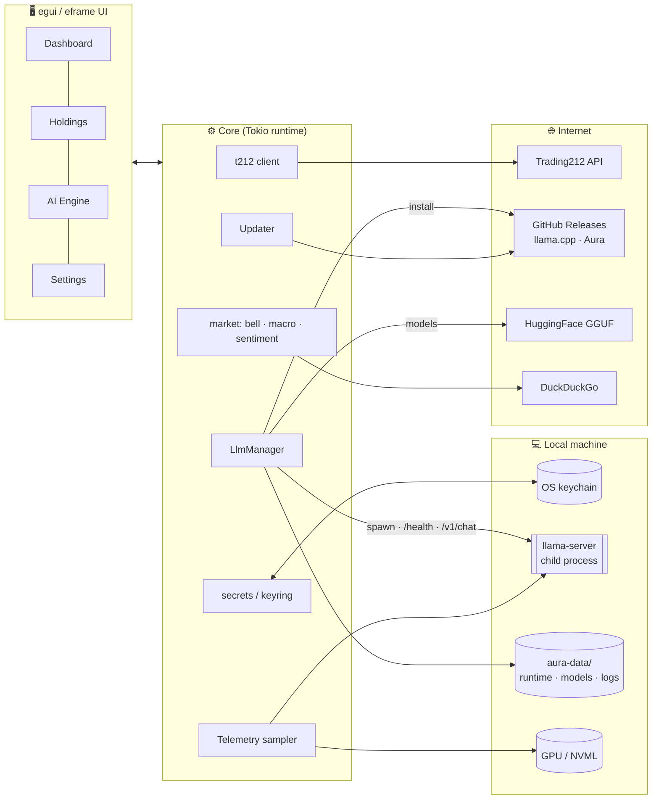

<div align="center">


<br/>


# Aura Portfolio

**Your Trading212 portfolio, analysed by an AI that never leaves your computer.**

A native, 100% Rust desktop dashboard with deep portfolio analytics, live market context,
and a zero-config local LLM analyst powered by `llama.cpp`.


<br/>


[**Download**](https://github.com/Akulav/t212-ai-dashboard/releases/latest) ·
[Features](#-features) ·
[Quick start](#-quick-start) ·
[Architecture](#-architecture) ·
[Contributing](CONTRIBUTING.md)

</div>

---

> [!IMPORTANT]
> Aura is **read-only by default**. Write access (placing orders) must be enabled explicitly every
> session and resets to read-only on restart. Nothing in Aura is financial advice.

## 📸 Screenshots

<div align="center">


| Holdings | Dividends |
|:---:|:---:|
|  |  |
| **AI Insights** | **Local AI engine** |
|  |  |

<sub>Captured from the real app in demo mode (<code>AURA_DEMO=1</code>), which uses a sample portfolio, not real account data.
Regenerate with <code>scripts/screenshots.ps1</code>.</sub>

</div>

## ✨ Features

<table>
<tr>
<td width="50%" valign="top">

### 📊 Portfolio analytics
- Trading212 API integration (Live & Practice)
- Portfolio history, holdings, cost basis and P/L
- Dividends received, monthly income, **average tax withheld** (net vs. gross)
- Upcoming dividends **projected** from each holding's payment cadence
- Incremental, rate-limit-aware sync with an offline cache
- 🔒 Read-only by default; opt-in write mode per session

</td>
<td width="50%" valign="top">

### 🌍 Market context
- 🔔 Live **Wall Street bell** countdown (DST and holidays handled)
- 🎈 Inflation (CPI YoY) · 🏦 M2 money supply · 🥇 Gold spot
- 📰 Live sentiment from DuckDuckGo search

</td>
</tr>
<tr>
<td valign="top">

### 🧠 Local AI analyst
- **AI Insights:** P/E, PEG, FCF yield, growth, margins and quarterly results (SEC EDGAR, US listings) feed a transparent 0–100 score and **buy-opportunity screen**; a local model writes the thesis, risks and recommendations
- **Zero-config:** downloads a portable `llama.cpp` build on first launch
- Picks **CUDA / Vulkan / Metal / CPU** to match your hardware
- **VRAM-aware model recommendations** with fit badges
- One-click GGUF downloads from HuggingFace (resumable)
- Explicit **load / unload**; closing the app always kills the model and frees memory

</td>
<td valign="top">

### 🛡 Built to be trusted
- API keys in the **OS keychain** (Credential Manager / Keychain / Secret Service)
- No telemetry and no cloud AI: your portfolio stays on your machine
- SHA-256-verified **auto-updater** from GitHub Releases
- 📈 Live **RAM / VRAM telemetry** widget for the LLM
- 📄 Branded **PDF reports** of your portfolio and AI insights (Typst)

</td>
</tr>
</table>

### Roadmap

| Phase | Scope | Status |
|:-----:|-------|:------:|
| 1 | App shell, theme, LLM runtime/model manager, telemetry, updater, CI/CD | ✅ |
| 2 | Trading212 client: account, positions, history, dividends, tax | ✅ |
| 3 | Macro data (CPI, M2, gold) + news sentiment | ⏳ |
| 4 | AI insights: fundamentals (SEC EDGAR), scoring, buy opportunities, local-LLM analysis | ✅ |
| 5 | Branded PDF reports (Typst) — "Powered by AI · Made by Akulav" | ✅ |

## 🚀 Quick start

### 1. Install
Download from the [**latest release**](https://github.com/Akulav/t212-ai-dashboard/releases/latest):

| System | Download | First run |
|---|---|---|
| **Windows 10/11 (x64)** | `Aura-Portfolio-Setup.exe` | SmartScreen: *More info → Run anyway* (the setup isn't code-signed). The wizard installs for your user only - no admin prompt. |
| **macOS (Apple Silicon)** | `Aura-Portfolio-macos-arm64.dmg` | Drag *Aura Portfolio* to Applications, then **right-click → Open** the first time (Gatekeeper: unidentified developer). |
| **Linux (x64)** | `aura-portfolio-linux-x64` | `chmod +x aura-portfolio-linux-x64 && ./aura-portfolio-linux-x64` - it installs itself and adds an app-menu entry. |

The bare programs (`aura-portfolio-windows-x64.exe`, `aura-portfolio-macos-arm64`, `aura-portfolio-linux-x64`) work
anywhere too: started from Downloads, each one installs itself (see below). Every file is listed in `SHA256SUMS.txt`.

### 2. Connect Trading212
In *Trading212 → Settings → API*, create a key with these permissions:

| Permission | Unlocks |
|---|---|
| **Account data** | cash, total value, realised P/L, total return vs. deposits |
| **Portfolio** | positions (required) |
| **History** (dividends, transactions) | dividends, tax withheld, deposits, projections |

Paste the key and secret into **Settings → Trading212 connection**. They go straight into your OS keychain. If a permission is missing, Aura still syncs everything else and tells you exactly what to enable.

### 3. Turn on the AI (zero config)
**AI Engine** tab:

1. Click **Install runtime**. Aura fetches the right `llama.cpp` build (CUDA, Vulkan, Metal or CPU).
2. Pick the model marked ⭐ (recommended for your RAM/VRAM) and click **Download**.
3. Click **Load**. When you're done, **Unload** frees all RAM/VRAM instantly.

That's it: no Python, no Docker, no Ollama.

> [!TIP]
> **Just looking?** Run with `AURA_DEMO=1` to explore every page with a built-in sample portfolio.
> No API key needed, and nothing is sent anywhere.

> [!TIP]
> **Where's my data?** In the app folder's `data` folder, next to the program (see
> [Installing, updating and uninstalling](#-installing-updating-and-uninstalling)). Your Trading212 key is not there:
> it's in the OS keychain. `AURA_DATA_DIR` points the data folder anywhere else.

### Build from source

```bash
git clone https://github.com/Akulav/t212-ai-dashboard && cd t212-ai-dashboard
cargo run --release
```

Linux needs: `pkg-config libdbus-1-dev libxkbcommon-dev libxcb-render0-dev libxcb-shape0-dev libxcb-xfixes0-dev libwayland-dev libgl1-mesa-dev`.

## 📦 Installing, updating and uninstalling

### The app folder
Aura lives in one folder per user. The program, and everything it keeps in `data/` (settings, the portfolio cache,
insights, AI models, the llama.cpp runtime, logs), stay together there:

| System | App folder | Shortcuts |
|---|---|---|
| Windows | `%LOCALAPPDATA%\Aura Portfolio` (the setup lets you pick another) | Start menu + desktop, *Settings → Apps* entry |
| macOS | `~/Library/Application Support/Aura Portfolio` | the app in Applications (or `~/Applications`) + desktop |
| Linux | `$XDG_DATA_HOME/aura-portfolio` or `~/.local/share/aura-portfolio` | app-menu entry + desktop launcher |

**Self-install.** Start the program from anywhere else (Downloads, the desktop, the Mac app) and it copies itself into
the app folder, adds the shortcuts and the Apps entry, starts from there and closes the copy you started. An existing
install is never downgraded: an older download only opens the installed (newer) one. It runs where it is instead with
`--here`, `--dir <folder>`, `AURA_DATA_DIR`, a folder that already holds an install (including a setup install in a
custom folder), on Linux without a desktop session, and when you built it yourself (`cargo`).

**From 0.x:** data from the old per-user folder (`…\akulav\AuraPortfolio`) is moved into the app folder on the first
start; the 0.2 setup's Apps entry is replaced by the new one.

### Updates
Aura checks GitHub a minute after start and every 6 hours (turn it off in *Settings*, or use **Check for updates** in
the sidebar). An update downloads this system's program, checks it against the release's `SHA256SUMS.txt`, swaps it in
(the old one is kept as `.old` until the next start) and restarts. **It replaces only the program** - your data, models,
settings and keychain entry are never touched. A program you built yourself never updates itself.

### Uninstalling
- **Windows:** *Settings → Apps → Aura Portfolio → Uninstall* (or *Start menu → Uninstall Aura Portfolio*). It stops a
  running Aura, removes the program and shortcuts, then asks whether to delete the folder with your data (default: No).
- **macOS / Linux / a self-installed Windows copy:** run `aura-portfolio --uninstall` from the app folder. It removes the
  shortcuts and the app-list entry, then asks before deleting the folder. On a Mac also drag the app out of Applications.
- Your Trading212 key stays in the keychain: remove it in *Settings → Remove* before uninstalling if you want it gone.

## 🩺 Troubleshooting

- **"GitHub shows no release" / update check failed.** No release is published yet, or GitHub is unreachable. For a
  private fork, give Aura a read-only token: put `github_token = <token>` in `data/local.config` (never commit it).
- **macOS: "can't be opened" or "is damaged".** The app isn't notarised. Right-click it → *Open* → *Open*. If macOS
  still says it's damaged, clear the download's quarantine flag:
  `xattr -dr com.apple.quarantine "/Applications/Aura Portfolio.app"`.
- **Windows: "Windows protected your PC".** SmartScreen doesn't know unsigned apps: *More info → Run anyway*.
- **Aura is already open.** One Aura runs per app folder; starting it again brings the open window to the front.

## 🏗 Architecture



### Tech stack

| Concern | Choice | Why |
|---|---|---|
| GUI | [`eframe`/`egui`](https://github.com/emilk/egui) | Pure Rust, single binary, GPU-accelerated, ideal for data-dense dashboards |
| Async | `tokio` | Downloads, API calls and health checks without blocking the UI |
| HTTP | `reqwest` + rustls | No OpenSSL dependency; easy cross-compilation |
| Local LLM | `llama.cpp` **`llama-server` subprocess** | No C++ toolchain at build time; ships the upstream CUDA/Vulkan/Metal builds; process isolation means *unload = kill = memory freed* |
| Telemetry | `sysinfo` + `nvml-wrapper` | Process RSS and per-process/device VRAM |
| Secrets | `keyring` | Native keychains on all three OSes |
| Updates | GitHub Releases + `self-replace` + SHA-256 | Swaps the running exe safely, even on Windows |
| PDF (phase 5) | `typst` (embedded) | Typeset-quality reports from templates, all in Rust |

### Process-lifetime guarantee
Closing Aura **always** frees the model's memory:

1. `on_exit` and a panic hook call `LlmManager::shutdown()` (kill + reap).
2. **Windows:** `llama-server` runs inside a Job Object with `KILL_ON_JOB_CLOSE`, so even if Aura is force-killed, the kernel kills the server.
3. **Linux:** `PR_SET_PDEATHSIG = SIGKILL`.
4. **macOS:** PID file plus orphan reaping on next launch.

## 🗂 Project layout

```text
t212-ai-dashboard/
├── VERSION               # the version (single source of truth: tools_dev/bump_version.py)
├── CHANGELOG.md          # one section per release - the release notes
├── .github/workflows/
│   ├── ci.yml            # versions agree · fmt · clippy · tests · rustdoc (3 OSes) · the setup compiles
│   └── release.yml       # VERSION changed → tests → build → Setup.exe / .dmg → GitHub Release
├── assets/               # icon.svg (master) + generated icon.ico/.icns/PNGs and wizard pictures
├── installer/            # aura-portfolio.iss (Inno Setup 6) · Info.plist (the Mac app)
├── tools_dev/            # bump_version.py · make_icons.py
├── src/
│   ├── main.rs           # entry point: options, self-install, one instance per folder, the window
│   ├── install.rs        # self-install, shortcuts, Apps entry, --uninstall
│   ├── updater.rs        # updates from GitHub releases (bare program + SHA256SUMS.txt)
│   ├── paths.rs          # the app folder's data folder (+ the move from 0.x)
│   ├── lib.rs            # crate docs + module map (#![warn(missing_docs)])
│   ├── config.rs · secrets.rs · net.rs · archive.rs · telemetry.rs
│   ├── t212/             # Trading212 API client
│   ├── portfolio/        # sync service, cache, analytics, demo data
│   ├── insights/         # fundamentals (SEC EDGAR), scoring, local-LLM analysis
│   ├── report/           # branded PDF report (Typst)
│   ├── llm/              # llama.cpp runtime, models, server process, GPU detection
│   ├── market/           # NYSE session clock
│   └── ui/               # egui app: theme, widgets, one file per page
└── CONTRIBUTING.md       # developer guide
```

## 🔐 Security

- Credentials are stored **only** in the OS keychain, never on disk, never logged (`Debug` is redacted).
- `.gitignore` excludes `.env*`, keys, credentials, models, runtimes and app data.
- Write mode needs an explicit confirmation and **always** resets to read-only on launch.
- Updates are verified against the release's published SHA-256 before installing.
- The LLM server binds to `127.0.0.1` only.

Found a vulnerability? Please open a private security advisory on GitHub.

## 🤝 Contributing

PRs welcome! See [**CONTRIBUTING.md**](CONTRIBUTING.md) for the dev setup, documentation standards,
and step-by-step guides for adding Trading212 endpoints, AI analyses, and models.

## 📜 License

[MIT](LICENSE) © akulav

<div align="center">
<br/>
<sub>Made with ♥ by <a href="https://github.com/akulav"><b>akulav</b></a> · Not affiliated with Trading 212 · Not financial advice</sub>
</div>
