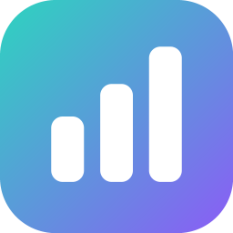

<div align="center">



# Aura Portfolio

**Your Trading212 portfolio, analysed by an AI that never leaves your computer. Made by Akulav.**

No telemetry. No cloud AI. No bloat. One file per system that installs and updates itself.

[](https://github.com/Akulav/t212-ai-dashboard/releases/latest)
[](https://github.com/Akulav/t212-ai-dashboard/releases)
[](https://github.com/Akulav/t212-ai-dashboard/actions/workflows/build.yml)


### [⬇ Download the latest release](https://github.com/Akulav/t212-ai-dashboard/releases/latest)

</div>

---

> [!IMPORTANT]
> Aura is **read-only by default**. Write access (placing orders) must be enabled explicitly every session and resets
> to read-only on restart. Nothing in Aura is financial advice.

## ⬇️ Download

One file per system. The same file installs the app the first time and updates it later.

| Platform | File | Notes |
| :-- | :-- | :-- |
| 🪟 **Windows 10 / 11** (x64) | [`AuraPortfolio-setup.exe`](https://github.com/Akulav/t212-ai-dashboard/releases/latest/download/AuraPortfolio-setup.exe) | Asks where to install. No admin rights needed. |
| 🐧 **Linux** (x64) | [`AuraPortfolio-linux-x64`](https://github.com/Akulav/t212-ai-dashboard/releases/latest/download/AuraPortfolio-linux-x64) | glibc 2.35+ (Ubuntu 22.04 or newer), X11 or Wayland |
| 🍎 **macOS** (Apple Silicon) | [`AuraPortfolio-macos-arm64`](https://github.com/Akulav/t212-ai-dashboard/releases/latest/download/AuraPortfolio-macos-arm64) | macOS 11+ |

Every release also ships `SHA256SUMS.txt` so you can verify your download.

## 📸 Screenshots

<div align="center">


| Holdings | Dividends |
|:---:|:---:|
|  |  |
| **AI Insights** | **Local AI engine** |
|  |  |

<sub>Captured from the real app in demo mode (<code>AURA_DEMO=1</code>), which uses a sample portfolio, not real account data.</sub>

</div>

## ✨ Features

<table>
<tr>
<td width="50%" valign="top">

### 📊 Portfolio analytics
- Trading212 API integration (Live & Practice).
- Portfolio history, holdings, cost basis and P/L.
- Dividends received, monthly income, **average tax withheld** (net vs. gross).
- Upcoming dividends **projected** from each holding's payment cadence.
- Incremental, rate-limit-aware sync with an offline cache.

</td>
<td width="50%" valign="top">

### 🧠 Local AI analyst
- **AI Insights:** P/E, PEG, FCF yield, growth, margins and quarterly results (SEC EDGAR for US stocks, ESEF/UKSEF annual reports for EU and UK stocks) feed a transparent 0–100
  score and a **buy-opportunity screen**; a local model writes the thesis, risks and recommendations.
- **Zero-config:** downloads a portable `llama.cpp` build and picks **CUDA / Vulkan / Metal / CPU** for your hardware.
- **VRAM-aware model recommendations**, one-click GGUF downloads, explicit load / unload.

</td>
</tr>
<tr>
<td width="50%" valign="top">

### 🌍 Market context & reports
- Live **Wall Street bell** countdown (DST and holidays handled).
- Live **RAM / VRAM telemetry** of the local model.
- Branded **PDF reports** of your portfolio and AI insights (Typst).

</td>
<td width="50%" valign="top">

### 🛡 Built to be trusted
- API keys in the **OS keychain** (Credential Manager / Keychain / Secret Service), never on disk.
- No telemetry and no cloud AI: your portfolio stays on your machine.
- **You choose the install folder**; one-click updates from GitHub, verified with SHA-256.
- Closing the app always stops the model and frees its memory.

</td>
</tr>
</table>

## 🚀 Getting started

### Windows
1. Download **`AuraPortfolio-setup.exe`** and run it (SmartScreen: *More info → Run anyway*; the setup isn't
   code-signed).
2. Pick the install folder (default `%LOCALAPPDATA%\Aura Portfolio`; any folder you can write to works, e.g.
   `D:\Apps\Aura Portfolio`). It adds Start-menu and (optional) Desktop shortcuts and an entry in *Settings → Apps*.
3. Updates install into the same folder without asking: in-app with one click, or by running a newer setup.

Uninstall from *Settings → Apps*. The uninstaller asks whether to delete your data too (default: keep it).

### Linux
```bash
chmod +x AuraPortfolio-linux-x64
./AuraPortfolio-linux-x64
```
It asks for an install folder (default `~/.local/share/aura-portfolio`), copies itself there and adds an app-menu
entry with icon and a Desktop launcher. *Just run it* skips installing. Running a newer download later offers to update
the installed copy in its folder. Uninstall with `aura-portfolio --uninstall` from the install folder.

### macOS (Apple Silicon)
```bash
chmod +x AuraPortfolio-macos-arm64
xattr -d com.apple.quarantine AuraPortfolio-macos-arm64
./AuraPortfolio-macos-arm64
```
It asks for an install folder (default `~/Applications/Aura Portfolio`) and creates `Aura Portfolio.app` there.

### Connect Trading212
In *Trading212 → Settings → API*, create a key with **Account data**, **Portfolio** and **History** permissions and paste
the key and secret into **Settings → Trading212 connection**. They go straight into your OS keychain. If a permission is
missing, Aura still syncs everything else and tells you exactly what to enable.

### Turn on the AI
On the **AI Engine** page: **Install runtime**, then **Download** the model marked ⭐ (recommended for your RAM/VRAM),
then **Load**. No Python, no Docker, no Ollama.

> 💡 **Just looking?** Start it with `AURA_DEMO=1` to explore every page with a built-in sample portfolio. No API key
> needed, and nothing is sent anywhere.

## 📁 Where your data lives

**In the install folder you chose**, in its `data` folder next to the program. Install on `D:\Apps\Aura Portfolio` and
every setting, cached portfolio, AI model and download goes to `D:\Apps\Aura Portfolio\data` too; nothing goes to
`%APPDATA%`, `~/.config` or other system folders. Outside that folder there are only the system's own entries for an
installed app (shortcuts, the *Apps* entry, the Linux menu entry) and your Trading212 key in the OS keychain.

| Path | Contents |
| :-- | :-- |
| `data/settings.json` | preferences |
| `data/` (cache files) | portfolio history, insights, reports index |
| `data/models/` | downloaded GGUF models |
| `data/runtime/` | the llama.cpp runtime |
| `data/logs/` | logs, including `llama-server.log` |
| `data/downloads/` | downloads in progress (including a Windows update setup) |
| `.aura-app` | marks the install folder |

Set `AURA_DATA_DIR` to use a different data folder.

## 🖥️ Command line

| Flag | Meaning |
| :-- | :-- |
| `--version` | Print the version and exit |
| `--check-update` | Ask GitHub whether a newer release exists |
| `--here` | Run where the program is, without offering to install (Linux/macOS) |
| `--dir <folder>` | Use another app folder (data in `<folder>/data`) |
| `--uninstall` | Remove the installed app (Windows: starts the uninstaller) |

## 🩺 Troubleshooting

- **macOS: "can't be opened" or "is damaged".** The app isn't notarised. Right-click it → *Open* → *Open*, or clear the
  quarantine flag: `xattr -dr com.apple.quarantine "~/Applications/Aura Portfolio/Aura Portfolio.app"`.
- **Windows: "Windows protected your PC".** SmartScreen doesn't know unsigned apps: *More info → Run anyway*.
- **Aura is already open.** One Aura runs per install folder; starting it again brings the open window to the front.
- **Update check failed.** GitHub is unreachable, or (for a private fork) put a read-only `github_token = <token>` in
  `data/local.config`.

<details>
<summary><b>🛠️ For maintainers: building, architecture and releases</b></summary>

### Building from source

```bash
git clone https://github.com/Akulav/t212-ai-dashboard && cd t212-ai-dashboard
cargo run --release
```

Linux needs: `pkg-config libdbus-1-dev libxkbcommon-dev libxcb-render0-dev libxcb-shape0-dev libxcb-xfixes0-dev
libwayland-dev libgl1-mesa-dev`. Programs built with `cargo` (under `target/`) never install or update themselves.

The Windows setup needs [Inno Setup 6](https://jrsoftware.org/isinfo.php):

```bash
iscc /DAppVersion=1.1.0 /DExe=%CD%\target\release\aura-portfolio.exe installer\aura-portfolio.iss
```

It writes `dist\AuraPortfolio-setup.exe`. `python tools_dev/make_icons.py` redraws every icon and installer picture from
`assets/icon.svg`.

### Publishing a release

Releases are fully automated by [`.github/workflows/build.yml`](.github/workflows/build.yml):

1. `python tools_dev/bump_version.py X.Y.Z` (updates `VERSION`, `Cargo.toml`, `Cargo.lock` and adds a `CHANGELOG.md`
   section), then fill in the changelog.
2. Push to `main`.
3. If no release `vX.Y.Z` exists, CI lints, tests and builds all three systems, tags the commit and publishes a GitHub
   release with exactly three programs, `AuraPortfolio-setup.exe`, `AuraPortfolio-linux-x64` and
   `AuraPortfolio-macos-arm64`, plus `SHA256SUMS.txt`.

### How updates are applied

Aura checks GitHub a minute after start and every 6 hours (or with *Check for updates*). One click downloads this
system's file and checks it against `SHA256SUMS.txt`; *Restart into vX.Y.Z* then

- **Windows:** runs `AuraPortfolio-setup.exe /VERYSILENT /UPDATE` with the current install folder. The setup closes Aura,
  installs into the same folder and starts the new version.
- **Linux / macOS:** swaps the program in the install folder in place (re-signing the app on macOS) and restarts.

### Architecture

| Concern | Choice |
|---|---|
| GUI | [`eframe`/`egui`](https://github.com/emilk/egui): pure Rust, single binary, GPU-accelerated |
| Async / HTTP | `tokio` + `reqwest` with rustls |
| Local LLM | `llama.cpp` **`llama-server` subprocess**: unload = kill = memory freed |
| Telemetry | `sysinfo` + `nvml-wrapper` |
| Secrets | `keyring` (native keychains on all three OSes) |
| PDF reports | `typst` (embedded) |

Closing Aura **always** frees the model's memory: `on_exit` and a panic hook kill the server; on Windows it runs in a
Job Object with `KILL_ON_JOB_CLOSE`, on Linux with `PR_SET_PDEATHSIG`, and on macOS orphans are reaped on next launch.
See [CONTRIBUTING.md](CONTRIBUTING.md) for the project layout and developer guides.

</details>

## 🔐 Security

- Credentials are stored **only** in the OS keychain, never on disk, never logged.
- Write mode needs an explicit confirmation and **always** resets to read-only on launch.
- Updates are verified against the release's published SHA-256 before installing.
- The LLM server binds to `127.0.0.1` only.

Found a vulnerability? Please open a private security advisory on GitHub.

## 🙏 Credits

Icons by [Phosphor Icons](https://phosphoricons.com) (MIT). Local inference by [llama.cpp](https://github.com/ggml-org/llama.cpp) (MIT).
Fundamentals from [SEC EDGAR](https://www.sec.gov/edgar) and [filings.xbrl.org](https://filings.xbrl.org) (ESEF/UKSEF), LEIs from [GLEIF](https://www.gleif.org), exchange rates from the ECB via [Frankfurter](https://frankfurter.dev). PDF typesetting by [Typst](https://typst.app) (Apache-2.0).

---

<div align="center">

**Made with ❤️ by [Akulav](https://github.com/Akulav)**

<sub>© 2026 Akulav. Source-available under the <a href="LICENSE">Akulav Source-Available License</a>. Not affiliated with Trading 212. Not financial advice.</sub>

</div>
